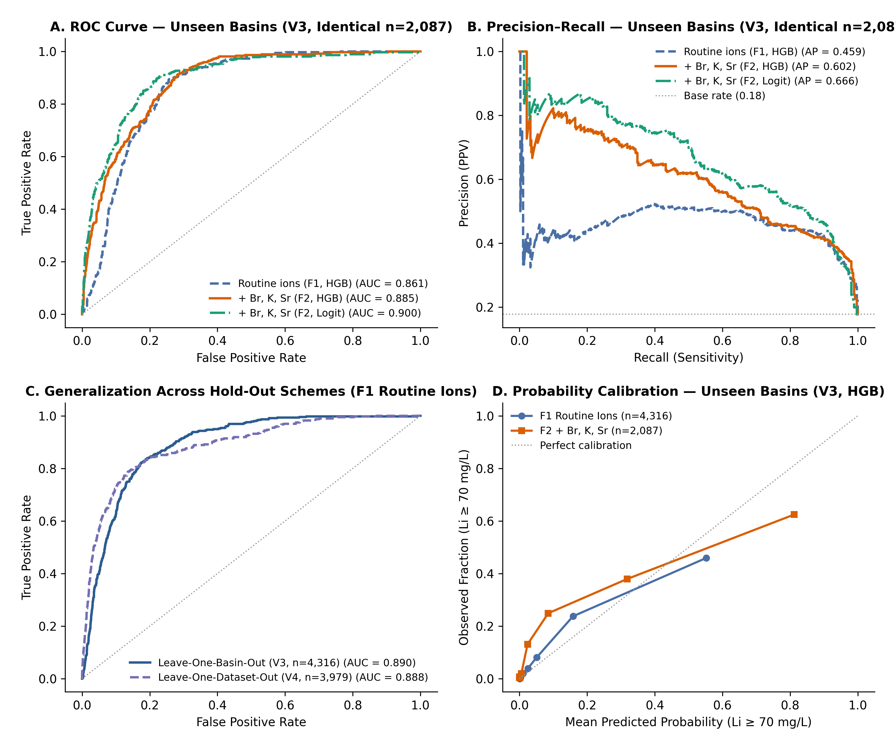
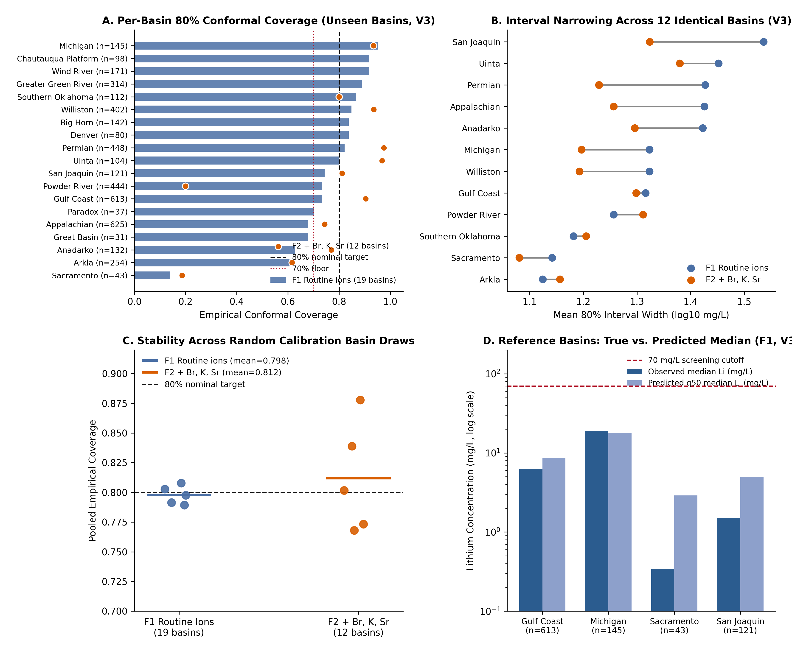
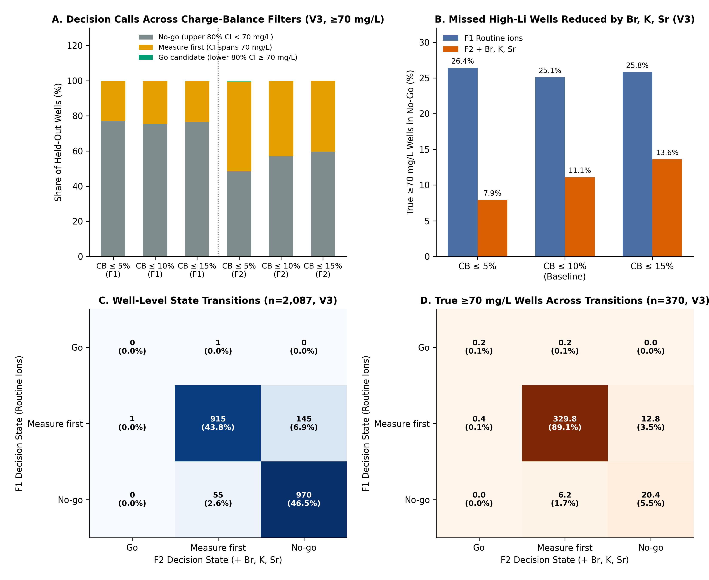
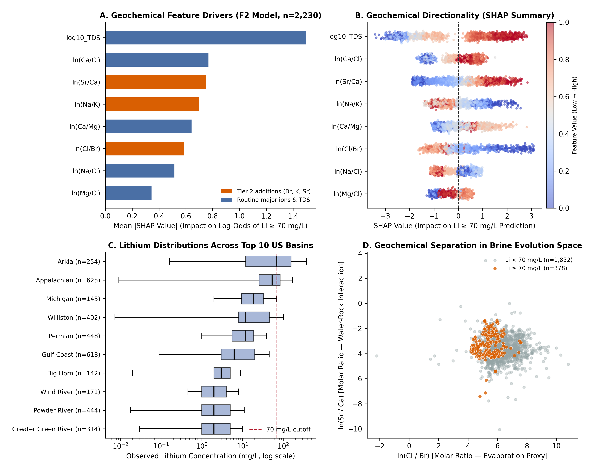
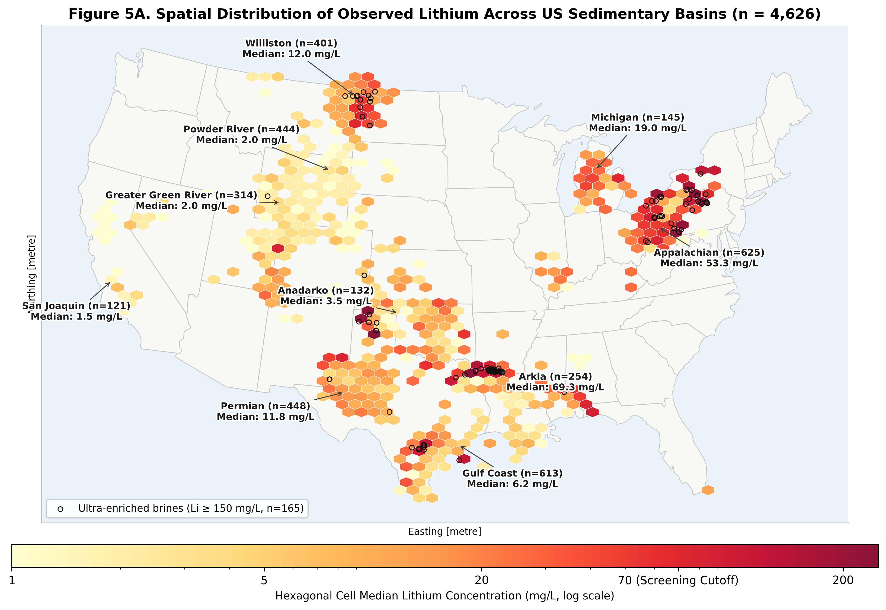
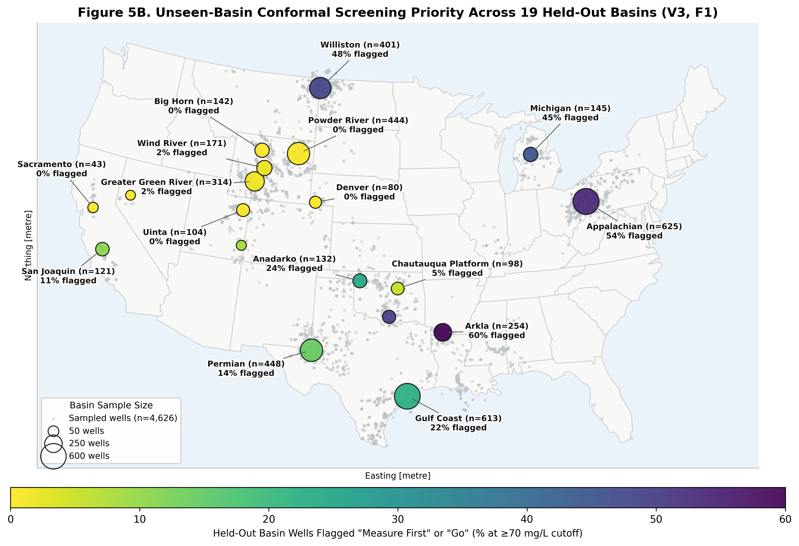
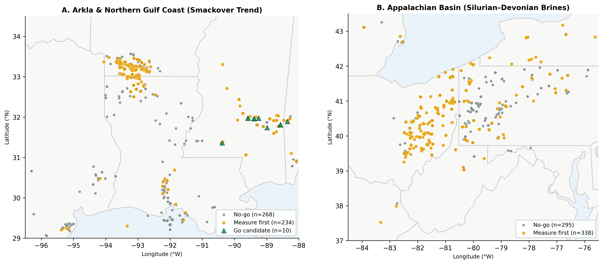

# DLE Brine Intelligence: Conformal Machine Learning for Lithium Screening in Oilfield Formation Waters

**Author:** Olanihun Maroof Ajadi | B.Sc. Geology & Mineral Sciences  
**Live Interactive ML Screener & US Map:** [https://blocksane.github.io/DLE-BRINE-INTELLIGENCE-/](https://blocksane.github.io/DLE-BRINE-INTELLIGENCE-/)  
**Domain:** Energy Geoscience · Hydrogeochemistry · Uncertainty-Aware Machine Learning  

---

## Live Interactive Web Application

Test the trained **Histogram Gradient Boosting (`HGB`) + Conformalized Quantile Regression (`CQR`)** models directly in your browser without installing Python:
- **Interactive Brine Screener:** [https://blocksane.github.io/DLE-BRINE-INTELLIGENCE-/](https://blocksane.github.io/DLE-BRINE-INTELLIGENCE-/)
- **Interactive 4,626-Well Geospatial Map:** [https://blocksane.github.io/DLE-BRINE-INTELLIGENCE-/map.html](https://blocksane.github.io/DLE-BRINE-INTELLIGENCE-/map.html)

---

## Key Scientific & Operational Findings

| Metric / Evaluation Dimension | Routine Ions (`F1`: TDS, Na, Ca, Mg, Cl) | + Trace Ratios (`F2`: adds Br, K, Sr) | Operational Takeaway |
| :--- | :---: | :---: | :--- |
| **Unseen-Basin Discrimination (`V3`, Pooled ROC AUC)** | `0.890` (n=4,316) | `0.885` (n=2,087) | Strong cross-basin ranking using routine water chemistry alone |
| **Paired Precision (`V3`, Identical n=2,087, AP)** | `0.459` | **`0.602` (`HGB`) / `0.666` (`Logit`)** | Adding Br, K, and Sr lifts precision by +14 to +21 percentage points |
| **80% Conformal Interval Width (Paired n=2,087)** | `1.34 log10 mg/L` | **`1.25 log10 mg/L`** | Narrows prediction uncertainty and resolves 145 uncertain wells to `No-go` |
| **Missed High-Li Wells (`pos_in_nogo_share`, >= 70 mg/L)** | `25.1%` | **`11.1%`** | Cuts false-negative leakage by more than half across unseen basins |
| **Charge-Balance Sensitivity (`|CB| <= 5% / 10% / 15%`)** | `0.903 / 0.890 / 0.891` | `0.886 / 0.885 / 0.884` | Rankings and near-zero unseen `Go` rates remain stable across QC filters |

---

## Visual Summary (300-DPI Publication Figures)

### 1. Cross-Basin Discrimination & Probability Calibration

### 2. Conformal Uncertainty & Per-Basin Coverage (19 Held-Out Basins)

### 3. Decision Actionability & Charge-Balance Sensitivity (`|CB| <= 5%, 10%, 15%`)

### 4. Geochemical Explainability (`SHAP` Drivers & Brine Evolution Space)

### 5. Geospatial Distribution & Regional Screening Maps

